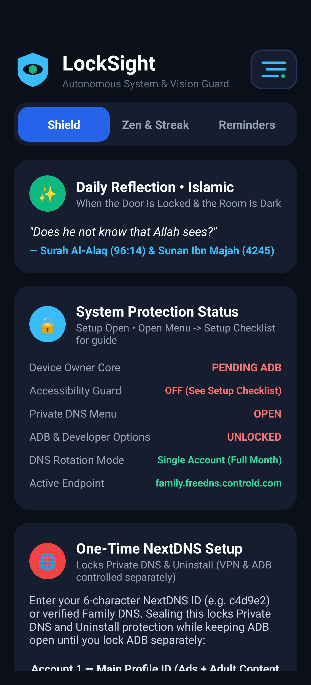
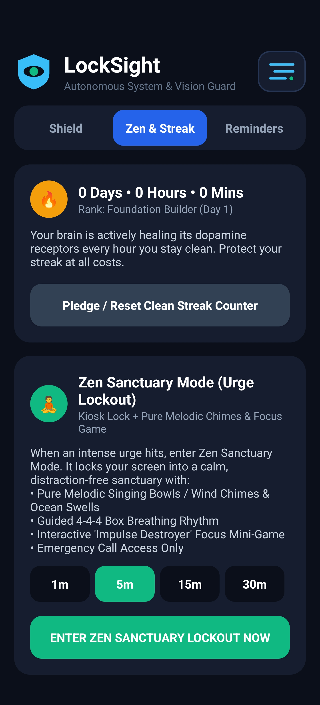
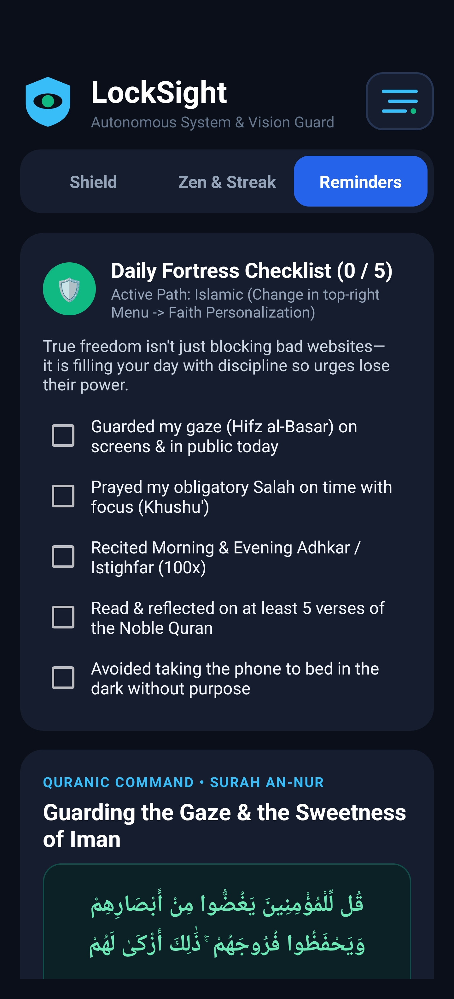
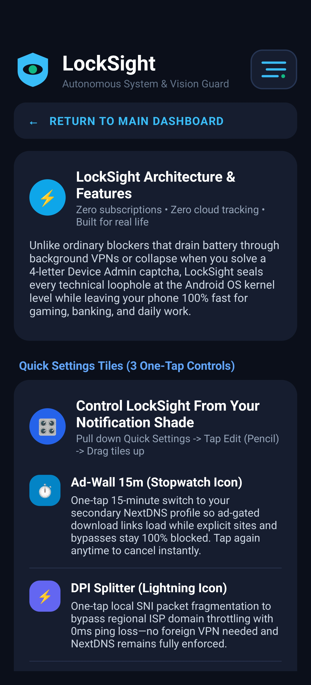
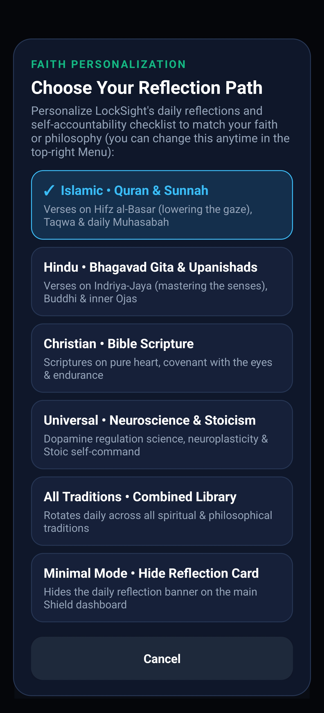

# LockSight

A free, open-source Android content shield built for people who are tired of bypassing their own blockers at 2 AM.

[](https://github.com/Techie-irfu/LockSight/releases/latest)
[-10B981?style=flat-square)](https://github.com/Techie-irfu/LockSight/releases)
[](./LICENSE)
[](https://ko-fi.com/techieirfu)

---

## Screenshots

<p align="center">
  
  
  
  
  
</p>

---

## Why I Built LockSight

I spent over a year testing almost every blocker available on Android — Bulldog, BlockerX, Lock Me Out, Stay Focused, CleanBrowsing, Control D, and NextDNS. Every single one failed the same real-world test: if you actually know how Android works, you can disable them in 10 seconds when an urge hits.

- Ordinary blockers rely on **Device Admin**, which Android lets you deactivate with a simple captcha.
- VPN-based blockers drain battery and spike gaming ping.
- Free DNS providers either break everyday apps (YouTube comments, ad-gated downloads) or hit a 300,000-query cap and silently turn off mid-month.
- Locking down your entire Settings app or Play Store turns your phone into a brick.

**LockSight** seals every technical bypass route at the Android OS level while keeping your phone 100% normal for gaming, banking, YouTube comments, OS updates, and daily life — completely free, with zero ads and zero cloud tracking.

---

## How LockSight Compares

| Bypass / Everyday Pain Point | Typical Play Store Blockers | LockSight |
| :--- | :--- | :--- |
| **Turning off Private DNS** | Cannot lock Android's DNS menu | Uses **Enterprise Device Owner** to permanently gray out Private DNS |
| **Uninstalling / Force Stopping** | Bypassed via Device Admin captcha | Uninstall & Force Stop grayed out by Android OS |
| **Gaming Ping & Battery Drain** | 24/7 local VPN adds ping & heat | Native Android Private DNS (**0ms ping impact**, 0% idle battery) |
| **NextDNS 300k Free Monthly Limit** | Filtering stops mid-month | **15-Day Dual-Account Auto-Rotation** (600,000 free queries/month) |
| **Ad-Shorteners Blocking Downloads** | Forces permanent DNS unlock | **10m / 30m / 1h Ad-Wall Bypass** + Quick Settings tile (adult sites stay 100% blocked) |
| **ISP Domain Throttling** | Requires third-party VPN | Built-in **Local DPI Packet Fragmentation** + Quick Settings tile |
| **Video Editors Needing a VPN (CapCut)** | Leaving VPN open exposes browsers | **Creative Apps VPN Mode** unlocks editors while suspending browsers & Play Store installs |
| **Offline Videos, Telegram & Browsers** | DNS cannot see local files or encrypted apps | **Aegis Neural Core** — offline 16 KB-aligned NudeNet v3 (`320n.onnx`) with 0.02ms static-frame skipping |
| **Strict UPI & Banking Apps** | Breaks payments or forces uninstall | **Safe Payment Mode** (3-min auto-restore) + Quick Settings tile + Play-Store ADB installer |
| **Local Wireless ADB (`LADB`/`Termux`)** | Anyone can remove admin on-device | Separate **ADB Lock** behind a **12h/24h Daylight-only (7 AM – 6 PM)** timer |

---

## Core Features

- **3 One-Tap Quick Settings Tiles:** Control **Ad-Wall 15m**, **DPI Splitter**, and **Safe Pay** directly from your notification shade without opening the app.
- **Aegis Neural Core (3 Sensitivity Levels):** 100% offline anatomical vision guard running on Microsoft ONNX Runtime (`320n.onnx`). Includes face-overlap rejection, zero-CPU idle sleep, and separate exclusion lists for **Games/Emulators** and **Banking/KYC/Document apps**.
- **Universal Search & Mixed-Domain Guard:** Blocks explicit searches and mixed-content torrent sites across browsers and social apps while exempting AI chats (Gemini, ChatGPT, Claude), Notes, and WhatsApp.
- **Zen Sanctuary Mode & Clean Streak:** Full-screen urge lockout with melodic wind chimes/ocean swells, 4-4-4 box breathing, and an interactive focus game.
- **Multi-Faith Personalization:** Tailor daily reflections and accountability checklists to **Islamic**, **Hindu**, **Christian**, **Universal (Neuroscience/Stoicism)**, or **Minimal** mode.
- **Zero-Backend In-App Updater:** Checks GitHub Releases directly from `Menu -> About`.
- **Optional Multi-User & System Cloner Vault:** Blocks secondary hidden OS spaces (Multiple Users, Guest Mode, OnePlus/ColorOS System Cloner, Work Profiles, and Android 15+ Private Space) behind a 12-hour Daylight-only countdown, while keeping regular Dual Apps (like Dual WhatsApp) and File Private Safe 100% usable.

---

## Complete Installation & Setup Guide

> **Requirements:** Android 11.0 (API 30) or higher, and a Windows/Mac/Linux PC with USB cable for the one-time 2-minute Device Owner activation.

### Step 1: Set Up NextDNS (Before Sealing)
1. Create a free account at [nextdns.io](https://nextdns.io).
   - **For a strict solo lockout (Recommended):** Sign up with a disposable email (such as `temp-mail.org`).
2. Configure your **Main Profile**:
   - **Security:** Turn ON Threat Intelligence, AI-Driven Threat Detection, Dynamic DNS, and CSAM. *(Keep Newly Registered Domains OFF if you visit rotating domains.)* Under TLDs, block `.xxx`, `.porn`, `.sex`, `.adult`, `.sexy`.
   - **Privacy:** Keep **NextDNS Ads & Trackers Blocklist** ON and turn **Allow Affiliate & Tracking Links** ON (prevents broken shopping links).
   - **Parental Control:** Add **Pornography**, turn **SafeSearch** ON, turn **Block Bypass Methods** ON, and keep **YouTube Restricted Mode** OFF (so YouTube comments keep working).
   - **Settings:** Turn **Anonymized EDNS Client Subnet** ON and **Cache Boost** ON (lowest gaming ping + cuts monthly query usage nearly in half).
3. **Create Your Ad-Bypass Profile:** Scroll to the bottom of NextDNS **Settings**, click **Duplicate**, and remove *only* the Ad-Blocker list on the duplicate profile (keep Pornography & Bypass blocking 100% ON). Copy both 6-character profile IDs.
4. *(Optional — 600,000 Free Queries/Month)*: Repeat Steps 1–3 with a second free NextDNS account for **Account 2**. LockSight automatically rotates between Account 1 (Days 1–15) and Account 2 (Days 16–30).
5. **Burn the Account Credentials:** Once you have written down your profile IDs, change your NextDNS account password to random gibberish, log out, and close the temporary email tab so you cannot weaken your filter later.

---

### Step 2: Back Up Apps & Cloned Apps
Granting Enterprise Device Owner requires temporarily removing accounts from your phone for about 60 seconds.
- Back up **WhatsApp / Telegram** chats to cloud or local storage just to be safe.
- **Important:** Disable or delete any **Dual / Clone Apps** (OnePlus App Cloner, Xiaomi Dual Apps, Samsung Dual Messenger) and any extra Guest/Work profiles, otherwise Android will reject the Device Owner command. *(Your photos, downloads, and installed apps are not deleted.)*

---

### Step 3: Remove Accounts & Enable Brand Developer Options
1. Go to **Settings -> Passwords & accounts** (or **Users & accounts**) and temporarily remove every Google, WhatsApp, Work, and OEM account.
2. Enable **Developer Options** (tap Build Number / OS Version 7 times in About Device) and turn ON **USB Debugging**.
3. **Brand-Specific Required Toggles (Required for `WRITE_SECURE_SETTINGS`):**
   - **OnePlus / Oppo / Realme (OxygenOS 16.1+ / ColorOS 16.1 / 17+ / Realme UI 7+):** Scroll to the bottom of Developer Options and turn **ON** **`Disable system optimization`**. *(If hidden on a non-English phone, temporarily switch phone language to English, flip it ON, then switch back.)*
   - **OnePlus / Oppo / Realme (Older OxygenOS 11–15 / ColorOS 11–15):** Turn **ON** **`Disable permission monitoring`**.
   - **Xiaomi / POCO / Redmi (HyperOS / MIUI):** Turn **ON** **`Install via USB`** AND **`USB debugging (Security settings)`**. *(If `pm grant` still fails, turn **OFF** **`Turn on system optimization`** / **`Turn on MIUI optimization`** at the bottom of Developer Options.)*
   - **Vivo / iQOO (Funtouch / OriginOS):** Turn **ON** **`USB debugging`** (and **`USB debugging (Security settings)`** if listed).
   - **Samsung (One UI):** Go to **Settings -> Security and privacy -> Auto Blocker** and turn it **OFF** temporarily during USB setup.

---

### Step 4: Install & Activate LockSight

#### Option A: Full One-Click Windows Installer ZIP — **HIGHLY RECOMMENDED**
Download **`LockSight-vX.X.X-Full-Installer-Windows.zip`** from [Releases](https://github.com/Techie-irfu/LockSight/releases/latest), extract it, plug in your phone via USB, and double-click **`Setup-LockSight.bat`**.

**Why Option A is strongly recommended over installing the raw APK:**
1. **No need to pause Google Play Protect** during installation.
2. **Bypasses Android's grayed-out "Allow restricted settings" hunt** in Accessibility automatically.
3. **Automatically whitelists Background Battery Usage** so OEM battery killers don't stop LockSight.
4. **Best UPI & Banking App Compatibility:** Installs LockSight with the Play Store installer flag (`-i com.android.vending`), allowing apps like Paytm to work seamlessly even with Accessibility ON!

> **Watch your phone screen during `[2/5] Installing LockSight`:** On **OnePlus, Oppo, Realme, Vivo, iQOO, and Xiaomi**, a pop-up will appear on your phone asking to confirm the USB installation — tap **Continue / Install** so the script completes.

#### Option B: Activator-Only ZIP (If You Already Installed `LockSight-vX.X.X-arm64-v8a.apk`)
Download **`LockSight-vX.X.X-ADB-Activator-Only.zip`**, extract it, connect via USB, and double-click **`Activate-LockSight.bat`**.
*(Note: If you installed the raw APK on your phone, tap LockSight once in Accessibility while grayed out, then open **App Info -> `⋮` -> Allow restricted settings** to enable Accessibility.)*

#### Option C: Manual ADB Commands (Mac / Linux / `platform-tools` Users)
```bash
# 1. Install APK with Play Store installer flag (tap Continue/Install on phone if prompted)
adb install -i com.android.vending -r LockSight-vX.X.X-arm64-v8a.apk

# 2. Grant Enterprise Device Owner
adb shell dpm set-device-owner com.locksight.guard/.AdminReceiver

# 3. Grant Hands-Free Auto-Restore Permission (for Safe Payment Mode & Self-Heal)
adb shell pm grant com.locksight.guard android.permission.WRITE_SECURE_SETTINGS

# 4. Whitelist Background Battery Usage
adb shell dumpsys deviceidle whitelist +com.locksight.guard
```

Once finished, you can turn **`Disable system optimization`** back **OFF** (the granted permission stays saved!), **unplug your phone, and sign back into all your accounts.**

---

### Step 5: Seal DNS, Lock VPN & Lock ADB (Zero Loopholes)
1. Open **LockSight**, choose your **Faith Personalization**, and enter your NextDNS Account 1 (and optional Account 2) IDs.
2. Tap **SEAL & LOCK NEXTDNS PERMANENTLY** (locks Private DNS & Uninstall protection).
3. Open top-right **Menu -> Setup Checklist** and verify Steps 1–8 are green, including:
   - Turning **LockSight ON** in Accessibility.
   - Tapping **Lock VPN Now** (Step 7) so third-party VPNs cannot bypass NextDNS.
4. **Final Step:** Once everything is verified and working smoothly, tap **Lock ADB Now** (Step 9) to seal USB & Wireless ADB behind the 12h/24h Daylight-only timer.

---

## OEM Security & Background Protection (Important!)

Some phone brands include built-in security monitors that may block Accessibility actions until allowlisted:

- **OnePlus / Oppo / Realme (Phone Manager):** If you see *"Unauthorised device control blocked — LockSight"*, tap the notification -> **Allowlist** and add **LockSight** (or turn off *Phone Manager -> Viruses & risks -> Block suspicious app activities*).
- **Xiaomi / POCO / Redmi (Security App):** Enable **Autostart** for LockSight and lock LockSight in your Recent Apps view.
- **Vivo / iQOO (iManager):** Enable **Autostart** and **Allow high background power consumption** for LockSight.
- **Samsung (Device Care):** Add LockSight to **Battery -> Background usage limits -> Never auto sleeping apps**.

---

## Using UPI & Banking Apps (Don't Panic!)

Strict Indian UPI and banking apps monitor Accessibility Services for anti-fraud protection:
- If you installed via **Option A (`Setup-LockSight.bat`)**, apps like **Paytm** work normally even with Accessibility ON!
- For ultra-strict apps like **Google Pay (GPay)** — or if any banking app ever shows an Accessibility warning:
  1. Pull down Quick Settings and tap the **Safe Pay** tile **before** opening your payment app (or tap *Enter Safe Payment Mode* inside LockSight).
  2. Complete your payment normally — **Browsers and Shopping apps (Amazon, Flipkart) stay 100% open on locked NextDNS** so website checkouts never fail.
  3. After **3 minutes**, LockSight automatically turns Accessibility back ON and restores suspended media apps hands-free! *(If you installed without `WRITE_SECURE_SETTINGS`, simply tap the 3-minute notification to flip LockSight back ON.)*
  - *Tip for GPay:* If you accidentally open GPay *before* tapping Safe Pay and see the "Restart your phone" screen, tap **Safe Pay**, wait a few seconds inside GPay, and it will refresh back to the normal payment screen without needing a restart.

---

## Updating & Uninstalling (Undo ADB Commands)

- **First-Time Users:** Always use **Option A (`LockSight-vX.X.X-Full-Installer-Windows.zip`)** for the smoothest setup and best UPI/Banking compatibility.
- **Existing Users Updating to a New Version (Recommended — Keeps Paytm/UPI Working):** Download **`LockSight-vX.X.X-Updater-Windows.zip`** (the latest `vX.X.X` APK is already included inside!), extract it, unlock your 1-hour Daytime ADB window if ADB is locked, plug in via USB, and double-click **`Update-LockSight.bat`** (no account removal or Device Owner reset needed!).
- **Quick On-Phone Update:** Open **Menu -> About -> Check for App Updates** to download the APK directly on your phone. All Device Owner policies, NextDNS settings, and OEM Allowlists remain preserved.
- **Uninstalling / Revoking LockSight Later:** First unlock ADB inside LockSight using the 12h/24h Daylight timer, connect to a PC, and run:
```bash
adb shell dpm remove-active-admin com.locksight.guard/.AdminReceiver
adb shell pm revoke com.locksight.guard android.permission.WRITE_SECURE_SETTINGS
adb shell dumpsys deviceidle whitelist -com.locksight.guard
```
Once revoked, LockSight can be uninstalled normally like any standard app.

---

## Support the Project

LockSight is 100% free, ad-free, and open-source. If it helped you break free or reclaim your focus, you can support ongoing development:

- **International Supporters (Card / PayPal):** [Support on Ko-fi](https://ko-fi.com/techieirfu)
- **Indian Supporters (UPI — 0% Fee):** `md-irfu@ptyes` *(or scan QR below)*

<details>
<summary><strong>Click to reveal UPI QR Code (India — 0% Fee)</strong></summary>
<br>
<p align="center">
  <br>
  <sub>Scan with any UPI app (GPay, PhonePe, Paytm, BHIM) • UPI ID: <code>md-irfu@ptyes</code></sub>
</p>
</details>

---

## Feedback, Bugs & License

- **Found a bug or false positive?** Open an issue on [GitHub Issues](https://github.com/Techie-irfu/LockSight/issues) or email `locksight.dev@gmail.com`.
- **Credits:** Built by **Mohammed Irfan (@Techie-irfu)**. On-device anatomical vision powered by [NudeNet v3 (`320n.onnx`)](https://github.com/notAI-tech/NudeNet) (AGPL-3.0) and [Microsoft ONNX Runtime](https://github.com/microsoft/onnxruntime) (MIT).
- **License:** Licensed under **GNU AGPL-3.0** — see [LICENSE](./LICENSE).
